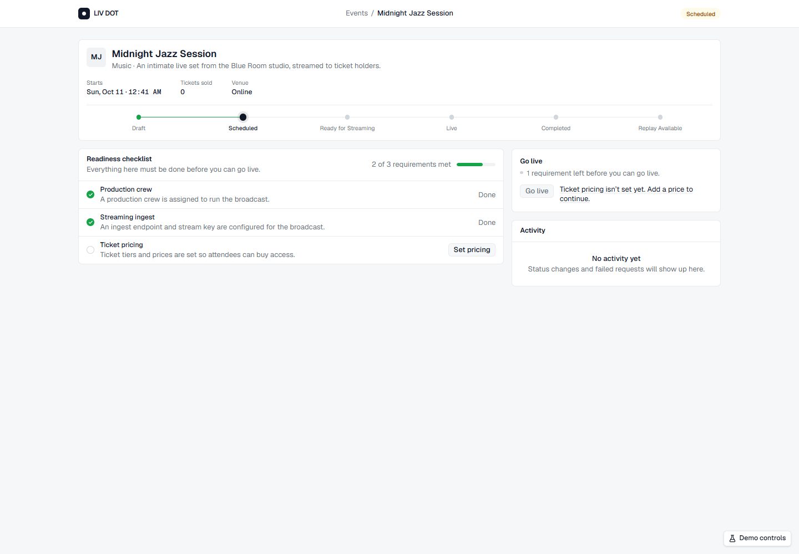
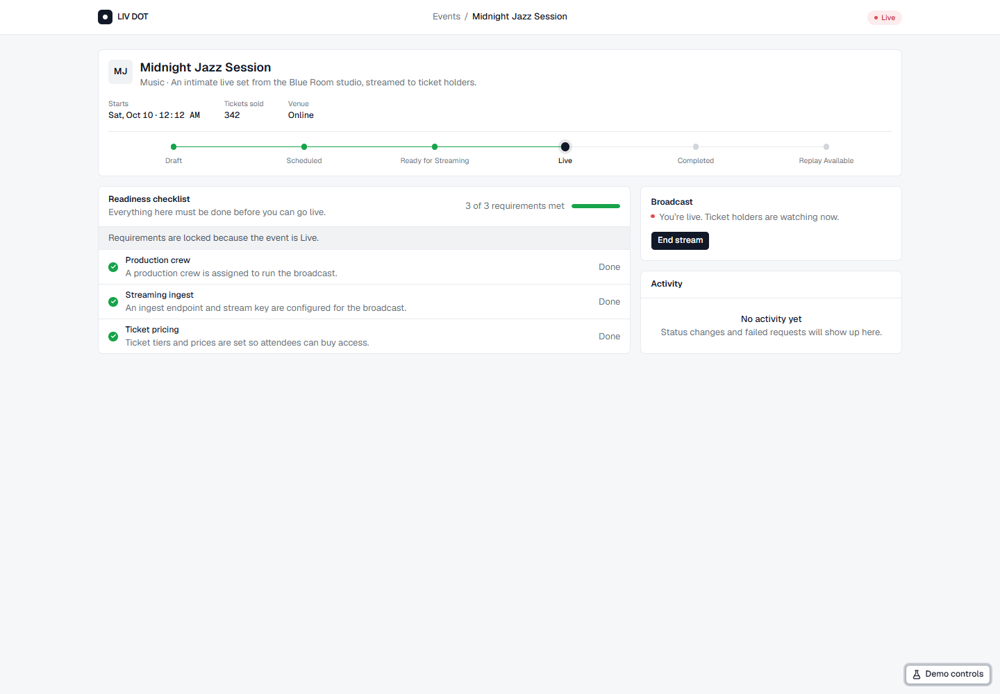
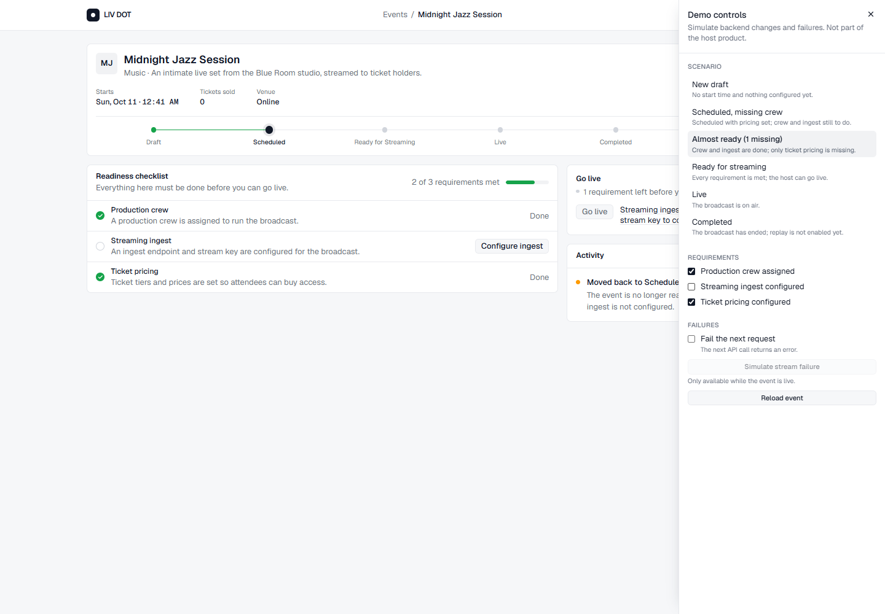
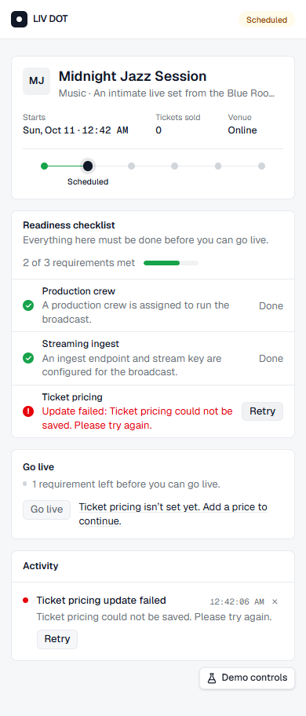

# LIV DOT · Host Event Dashboard

A single-page dashboard where a host prepares one live, ticketed event for broadcast. The
interface is driven entirely by backend state: it shows where the event is in its lifecycle,
which operational requirements are still missing, which action comes next, and exactly why an
action is blocked.

The backend is simulated with an in-memory mock API that has realistic latency and controllable
failures. A **Demo controls** drawer lets a reviewer reach every lifecycle state, change
requirements "behind the host's back", and force errors in a few clicks.



## Contents

- [What it does](#what-it-does)
- [Tech stack](#tech-stack)
- [Getting started](#getting-started)
- [Using the demo controls](#using-the-demo-controls)
- [Project structure](#project-structure)
- [Architecture at a glance](#architecture-at-a-glance)
- [Testing](#testing)
- [Accessibility](#accessibility)
- [Further documentation](#further-documentation)

## What it does

**Event lifecycle.** An event moves through six states:

```
Draft → Scheduled → Ready for Streaming → Live → Completed → Replay Available
```

**Operational readiness.** Before an event can be Ready for Streaming, three requirements must
be met: production crew assigned, streaming ingest configured, and ticket pricing configured.

**Behaviour the dashboard handles:**

| Situation                            | What the host sees                                                                                        |
| ------------------------------------ | --------------------------------------------------------------------------------------------------------- |
| A requirement is missing             | An empty circle in the checklist with a "Configure" action, and a matching blocker line next to "Go live" |
| The last requirement is met          | The event is promoted to Ready for Streaming automatically, and the activity feed records it              |
| A requirement is removed while Ready | The event regresses to Scheduled, and the feed explains which requirement caused it                       |
| An action is blocked                 | A muted button with short blocker lines beside it; each requirement blocker links to its checklist row    |
| A request is in flight               | A spinner and a progress label; repeat clicks are ignored                                                 |
| A request fails                      | The error appears on the affected row or card and in the activity feed, each with a retry                 |
| The event is live                    | A pulsing red "Live" status, a locked checklist, and "End stream" as the only action                      |
| The event cannot be loaded           | An error state with "Try again"                                                                           |



## Tech stack

| Area         | Choice                                                                    |
| ------------ | ------------------------------------------------------------------------- |
| UI           | React 19, TypeScript (strict), Vite 8                                     |
| Styling      | Tailwind CSS v4, shadcn/ui primitives (Radix), Geist font                 |
| State        | `useReducer` + React context, pure selectors (no state library)           |
| Backend      | In-memory mock API with artificial latency and failure injection          |
| Tests        | Vitest, React Testing Library, jest-dom, user-event                       |
| Code quality | ESLint (typescript-eslint strict, react-hooks), Prettier, `@/` path alias |

## Getting started

**Prerequisites:** Node.js 20.19+ or 22.12+ and npm.

```bash
npm install
npm run dev          # start the dev server at http://localhost:5173
```

| Command              | Purpose                                         |
| -------------------- | ----------------------------------------------- |
| `npm run dev`        | Start the development server                    |
| `npm test`           | Run the full test suite once                    |
| `npm run test:watch` | Run tests in watch mode                         |
| `npm run typecheck`  | Type-check the project with `tsc -b`            |
| `npm run lint`       | Lint with ESLint                                |
| `npm run format`     | Format with Prettier (`format:check` to verify) |
| `npm run build`      | Type-check and produce a production build       |
| `npm run preview`    | Serve the production build locally              |

## Using the demo controls

Open **Demo controls** from the button in the bottom-right corner. The drawer is non-modal, so
the dashboard stays visible and reacts while settings change.



**Scenario presets** replace the backend state and reload the dashboard:

| Preset                   | Starting state                                             |
| ------------------------ | ---------------------------------------------------------- |
| New draft                | Draft with no start time and nothing configured            |
| Scheduled, missing crew  | Scheduled; pricing set, crew and ingest still missing      |
| Almost ready (1 missing) | Scheduled; only ticket pricing missing (loaded by default) |
| Ready for streaming      | All requirements met; "Go live" is available               |
| Live                     | Broadcasting; requirements are locked                      |
| Completed                | Broadcast ended; replay not yet enabled                    |

**Other controls:**

- **Requirements** toggles each requirement on the backend, as if another team member changed it.
- **Fail the next request** makes the next API call fail, then switches itself off.
- **Simulate stream failure** drops a live broadcast (only available while live).
- **Reload event** fetches the event again; combine with "Fail the next request" to see the
  load error state.

**Suggested walkthroughs:**

1. **Happy path.** From "Almost ready", select **Set pricing**. The event becomes Ready for
   Streaming; select **Go live**.
2. **Regression.** From "Ready for streaming", untick _Streaming ingest configured_ in the drawer.
   The event drops back to Scheduled and the activity feed explains why.
3. **Failure and retry.** Turn on _Fail the next request_, then configure a requirement. The row
   and the feed both show the error; **Retry** succeeds.
4. **Scheduling.** From "New draft", pick a start time in the "Schedule" card. Past or empty
   times are explained instead of accepted.
5. **Stream failure.** From "Live", select **Simulate stream failure**. The event is marked
   Completed with an error entry in the feed.



## Project structure

```
src/
├── domain/                 Pure business rules (no React)
│   ├── event.ts            Event and status types, lifecycle order, labels
│   ├── requirements.ts     Requirement types, readiness summary
│   ├── request.ts          Async request state (idle | pending | success | error)
│   ├── evaluation.ts       BlockReason and Evaluation types
│   ├── guards.ts           Individual transition guards
│   ├── transitions.ts      Transition table and evaluateTransition()
│   ├── actions.ts          Host actions per status, requirement lock
│   ├── reconcile.ts        Automatic promotion/regression rule
│   └── snapshot.ts         The inputs every rule is evaluated against
├── services/
│   ├── eventApi.ts         Backend contract (EventApi, EventRecord, ApiError)
│   ├── mockApi.ts          In-memory backend with latency and failure injection
│   └── scenarios.ts        Preset backend states
├── state/
│   ├── types.ts            DashboardState, actions, notices, transition state
│   ├── eventReducer.ts     Pure reducer with stale-response protection
│   ├── notices.ts          Wording for status changes and failures
│   ├── selectors.ts        Derived values (available actions, readiness, locks)
│   ├── EventProvider.tsx   Side effects: calls the API and dispatches results
│   ├── eventDashboardContext.ts
│   └── useEventDashboard.ts
├── components/
│   ├── EventDashboard.tsx  The only component connected to state
│   ├── layout/             Top bar, breadcrumb and page frame
│   ├── event/              Event header, status pill, lifecycle stepper
│   ├── readiness/          Checklist, requirement rows and icons
│   ├── actions/            "Go live" card, action button, blocker lines, start time field
│   ├── activity/           Activity feed and entries
│   ├── simulation/         Demo controls drawer and its controls
│   ├── feedback/           Loading skeleton, error and empty states
│   └── ui/                 shadcn/ui primitives
├── lib/                    Formatting, error and exhaustiveness helpers
└── test/                   Test setup and shared fixtures
docs/
├── STATE_MODELING.md       How state, transitions and blocked states are modelled
├── IMPLEMENTATION_NOTES.md Structure, decisions, assumptions, trade-offs, next steps
└── images/                 Screenshots used in this README
```

Tests live next to the code they cover (`*.test.ts` / `*.test.tsx`).

## Architecture at a glance

```
 components ──reads──▶ selectors ──call──▶ domain (pure rules)
     │                    ▲
     │ dispatches         │ state
     ▼                    │
 EventProvider ──calls──▶ mock API ──validates with──▶ domain
     │                         │
     └──── results ────▶ reducer (stores what the backend returned)
```

- **The domain layer owns every rule.** `evaluateTransition()`, `getAvailableActions()` and
  `reconcileStatus()` are plain functions, used by both the UI and the mock backend.
- **The backend is authoritative.** Every mutation returns the full, already-reconciled event, so
  the client never decides a lifecycle state on its own.
- **Nothing derived is stored.** Whether the host can go live, why an action is blocked, and how
  many requirements are met are computed from the event and its requirements on every render.
- **Async work is modelled explicitly.** Each requirement and each transition has its own
  `idle | pending | success | error` state, expressed as discriminated unions.

See [docs/STATE_MODELING.md](docs/STATE_MODELING.md) for the full model.

## Testing

```bash
npm test
```

135 tests across 18 files:

| Layer      | Tests | Focus                                                                                   |
| ---------- | ----: | --------------------------------------------------------------------------------------- |
| Domain     |    57 | Every transition guard, invalid edges, blocked-reason content, promotion and regression |
| Services   |    24 | Mock API rules, copies vs. shared state, failure injection, scenario consistency        |
| State      |    34 | Reducer success and failure paths, stale responses, notices, selectors, provider flows  |
| Components |    17 | Blocked actions, checklist states, lifecycle semantics, end-to-end dashboard flows      |
| Other      |     3 | Formatting helpers and the app shell                                                    |

## Accessibility

- Status is always conveyed by text and shape, never by color alone.
- Blocked actions use `aria-disabled` rather than `disabled`, so they stay focusable and are
  described by their visible blocker lines through `aria-describedby`.
- Requirement blockers link to the requirement row, which receives focus.
- The lifecycle stepper marks the current step with `aria-current="step"`, and each step has a
  screen-reader state ("completed", "current step", "upcoming").
- The activity feed is a polite live region; errors use `role="alert"`.
- A skip link and visible focus styles are included, and the pulsing live indicator is
  disabled for users who prefer reduced motion.
- An automated axe-core audit (WCAG 2.1 AA) of the default, failure, live and drawer-open
  states reports no violations.

## Further documentation

- [docs/STATE_MODELING.md](docs/STATE_MODELING.md): how UI state is structured, how transitions
  are handled, and how the UI responds to blocked and incomplete states.
- [docs/IMPLEMENTATION_NOTES.md](docs/IMPLEMENTATION_NOTES.md): component structure, state
  management approach, assumptions, trade-offs, and possible next steps.
