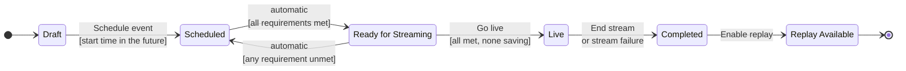
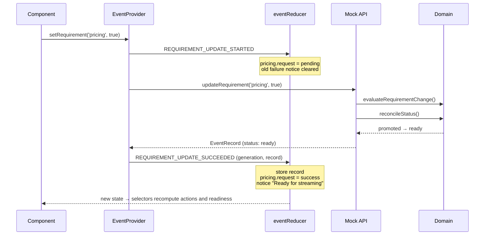

# State modelling

This document describes how the dashboard models its state, how lifecycle transitions are
decided, and how the interface responds when progress is blocked or configuration is incomplete.

The model follows three principles:

1. **Rules live in one place.** Lifecycle and readiness rules are plain TypeScript functions in
   `src/domain/` with no React imports. The UI, the reducer and the mock backend all call them.
2. **Store facts, derive conclusions.** State holds only what the backend reported (the event
   and its requirements) plus the status of in-flight requests. Everything else — available
   actions, blocked reasons, readiness counts — is computed by pure selectors.
3. **Make impossible states unrepresentable.** Discriminated unions ensure, for example, that a
   draft is the only event without a start time, and that a blocked action always has a reason.

---

## (a) How UI state is structured

### Domain types

An event's start time is optional only while it is a draft:

```ts
type EventStatus = 'draft' | 'scheduled' | 'ready' | 'live' | 'completed' | 'replay_available'
type PublishedStatus = Exclude<EventStatus, 'draft'>

interface DraftEvent extends EventDetails {
  status: 'draft'
  startsAt: string | null
}

interface PublishedEvent extends EventDetails {
  status: PublishedStatus
  startsAt: string // always present once scheduled
}

type Event = DraftEvent | PublishedEvent
```

Each requirement carries the state of its own request, so one requirement can be saving while
another has failed:

```ts
type RequirementId = 'crew' | 'ingest' | 'pricing'

type RequestState =
  | { status: 'idle' }
  | { status: 'pending' }
  | { status: 'success' }
  | { status: 'error'; message: string } // only failures carry a message

interface Requirement {
  id: RequirementId
  label: string
  description: string
  satisfied: boolean
  request: RequestState
}

type Requirements = Readonly<Record<RequirementId, Requirement>>
```

Rule outcomes share one shape. A blocked result must contain at least one reason, and a
requirement-related reason must name its requirement so the UI can link to it:

```ts
type BlockReason =
  | {
      code: 'requirement_unmet' | 'requirement_pending'
      message: string
      requirementId: RequirementId
    }
  | { code: GeneralBlockCode; message: string; requirementId?: never }

type Evaluation =
  { allowed: true; reasons: [] } | { allowed: false; reasons: [BlockReason, ...BlockReason[]] }
```

### Dashboard state

```ts
interface DashboardState {
  generation: number // bumped on every (re)load; older responses are ignored
  data: DashboardData
  notices: Notice[] // system feedback shown in the activity feed
  nextNoticeId: number
  failNextRequest: boolean // demo control
}

type DashboardData =
  | { status: 'loading' }
  | { status: 'error'; message: string }
  | { status: 'loaded'; event: Event; requirements: Requirements; transition: TransitionState }

type TransitionState =
  | { status: 'idle' }
  | { status: 'pending'; command: TransitionCommand }
  | { status: 'success'; command: TransitionCommand }
  | { status: 'error'; command: TransitionCommand; message: string }

type TransitionCommand =
  { actionId: 'schedule'; startsAt: string } | { actionId: 'goLive' | 'endStream' | 'enableReplay' }
```

Because `event`, `requirements` and `transition` only exist inside the `loaded` branch, no
component can read an event that has not arrived yet.

Notices are plain data. A failure notice stores what to retry as a `RetryIntent` rather than a
callback, and each notice has a `key` so a newer notice about the same thing replaces the older
one:

```ts
type RetryIntent =
  | { kind: 'requirement'; requirementId: RequirementId; satisfied: boolean }
  | { kind: 'transition'; command: TransitionCommand }
```

### Stored vs. derived

| Value                                 | Stored? | Source                                                |
| ------------------------------------- | :-----: | ----------------------------------------------------- |
| Event (status, start time, details)   |   Yes   | Backend response                                      |
| Requirement `satisfied` flags         |   Yes   | Backend response                                      |
| Request state per requirement         |   Yes   | Reducer, from request lifecycle actions               |
| Transition request state              |   Yes   | Reducer, from request lifecycle actions               |
| Notices                               |   Yes   | Reducer, when a status changes or a request fails     |
| Available host actions                |   No    | `selectAvailableActions` → `getAvailableActions`      |
| Whether an action is allowed, and why |   No    | `evaluateHostAction` / `evaluateTransition`           |
| "n of 3 requirements met"             |   No    | `selectReadinessSummary` → `getReadinessSummary`      |
| Whether requirements are locked       |   No    | `selectRequirementLock` → `evaluateRequirementChange` |
| Which transition is in flight         |   No    | `selectPendingCommand`                                |

Derived values are recomputed on every render. They are cheap (three requirements, six
statuses) and can never fall out of sync with the data they describe.

---

## (b) How transitions are handled

### Lifecycle



### Transition table

Every allowed edge is declared once in `TRANSITIONS` (`src/domain/transitions.ts`). Any edge not
in the table is invalid.

| Id             | From        | To                 | Trigger | Guards                                                            |
| -------------- | ----------- | ------------------ | ------- | ----------------------------------------------------------------- |
| `schedule`     | `draft`     | `scheduled`        | host    | `requireFutureStartTime`                                          |
| `promote`      | `scheduled` | `ready`            | system  | `requireAllRequirementsMet`                                       |
| `regress`      | `ready`     | `scheduled`        | system  | `requireSomeRequirementUnmet`                                     |
| `goLive`       | `ready`     | `live`             | host    | `requireAllRequirementsMet`, `requireNoPendingRequirementChanges` |
| `endStream`    | `live`      | `completed`        | host    | none                                                              |
| `enableReplay` | `completed` | `replay_available` | host    | none                                                              |

A guard is a pure function `(snapshot, now) => BlockReason[]`; an empty array means it passes.
Passing `now` in keeps the time-based guard deterministic in tests.

### Evaluating a transition

- `evaluateTransition(snapshot, to, now)` looks up the edge from the current status to `to`. If
  there is none, the result is blocked with an `invalid_transition` reason. Otherwise it runs
  the edge's guards and collects every reason, so the host sees all blockers at once rather than
  one at a time.
- `evaluateHostAction(snapshot, actionId, now)` handles actions shown before their source status
  is reached. While Scheduled, "Go live" is evaluated as blocked with a `wrong_status` reason
  _plus_ whatever the Go-live guards would still require, so the host can see exactly what
  stands between them and the broadcast.
- `getAvailableActions(snapshot, now)` returns the host actions offered in the current status,
  each with its evaluation.
- `evaluateRequirementChange(snapshot)` locks requirements once the event is Live or later.

### Automatic promotion and regression

`reconcileStatus(snapshot)` applies the system transitions after any change:

```ts
type Reconciliation =
  | { kind: 'unchanged' }
  | { kind: 'promoted'; event: PublishedEvent }
  | { kind: 'regressed'; event: PublishedEvent; unmetRequirementIds: RequirementId[] }
```

It only ever acts on Scheduled and Ready events; a draft is never promoted, and a live or
completed event never regresses.

### Who applies the rules

The mock backend (`src/services/mockApi.ts`) owns the event record and uses the same domain
functions as the UI:

- Host actions are validated with `evaluateTransition`; a blocked request is rejected with the
  first reason's message.
- Requirement changes are validated with `evaluateRequirementChange`.
- After every change the backend calls `reconcileStatus`, then returns the full, reconciled
  `EventRecord`.

The client therefore never computes the next lifecycle status itself. It stores what the backend
returned and compares the previous and next status to decide which notice to show.

### Request lifecycle



On failure the provider dispatches `REQUIREMENT_UPDATE_FAILED`. The requirement keeps its previous
`satisfied` value, its request becomes `{ status: 'error', message }`, and a notice with a
`RetryIntent` is added. Transitions follow the same pattern with `TRANSITION_*` actions.

### Concurrency and stale responses

- **Superseded responses.** Every load (including a scenario reset) increments `generation`.
  Result actions carry the generation they were started in, and the reducer ignores any result
  from an older generation. A slow response cannot overwrite a newer scenario.
- **Duplicate requests.** The provider ignores a requirement update while that requirement is
  already pending, and a host action while another transition is pending.
- **Independent requests.** When one requirement's request settles, the other requirements keep
  their own request states, so concurrent updates do not clear each other's spinners.
- **Exhaustiveness.** The reducer and the status switches either end in `assertNever` or return
  a typed value from every branch, so adding a new action or status without handling it is a
  compile-time error.

---

## (c) How the UI responds to blocked and incomplete states

| State                                   | Where it shows                     | What the host sees                                                                                                                         |
| --------------------------------------- | ---------------------------------- | ------------------------------------------------------------------------------------------------------------------------------------------ |
| Requirement missing                     | Readiness checklist                | Empty circle and a "Configure" action (for example "Set pricing"). Screen readers hear "(Missing)".                                        |
| Action blocked                          | "Go live" card                     | A small, muted outline button with short blocker lines beside it, such as "Ticket pricing isn't set yet. Add a price to continue."         |
| Blocker caused by a requirement         | "Go live" card → checklist         | The blocker line is a link that moves focus to that requirement's row.                                                                     |
| Requirements incomplete while Scheduled | "Go live" card status line         | "1 requirement left before you can go live."                                                                                               |
| Draft without a valid start time        | "Schedule" card                    | A start time field; the "Schedule event" button stays blocked with "Set a start date and time…" or "The start time must be in the future." |
| Request in flight                       | Row or card                        | Spinner and "Saving…" / "Going live…"; further clicks are ignored.                                                                         |
| Request failed                          | Row or card, and the activity feed | The error message in place ("Update failed: …" or "Last attempt failed: …") and a feed entry, each with a retry.                           |
| Readiness lost while Ready              | Activity feed                      | A warning entry: "Moved back to Scheduled. The event is no longer ready for streaming. Streaming ingest is not configured."                |
| Event live or finished                  | Checklist                          | "Requirements are locked because the event is Live." Configure actions are hidden.                                                         |
| Stream dropped                          | Activity feed                      | An error entry: "Stream interrupted", and the event moves to Completed.                                                                    |
| Event loading                           | Whole page                         | A skeleton with the same shape as the dashboard.                                                                                           |
| Event failed to load                    | Whole page                         | An error state with the backend's message and "Try again".                                                                                 |

### Blocked actions in detail

- The button uses `aria-disabled` instead of `disabled`, so it stays in the tab order and can be
  read by screen readers. Activating it does nothing.
- The button is connected to its blocker lines with `aria-describedby`, so the reasons are
  announced with the button.
- Blocker wording comes from the domain's `BlockReason`s. For missing requirements the UI uses
  more actionable copy keyed by `requirementId`, and drops the generic "must be Ready for
  Streaming" reason because the card's status line already says where the event stands
  (`toBlockerLines` in `src/components/actions/blockerCopy.ts`). The decision about _whether_ an
  action is blocked is never made in a component.

### Failures are never ambiguous

After any failed request the UI shows three things: the previous, still-valid data (nothing is
applied optimistically), the error message at the place the host acted, and a retry. Starting the
retry clears the old failure notice, so stale errors do not linger.
